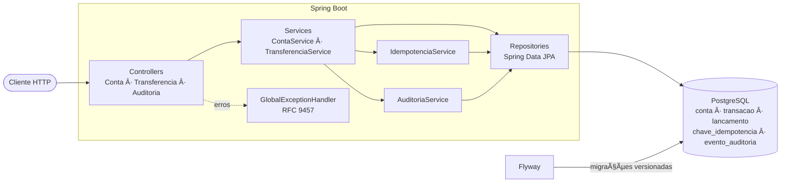
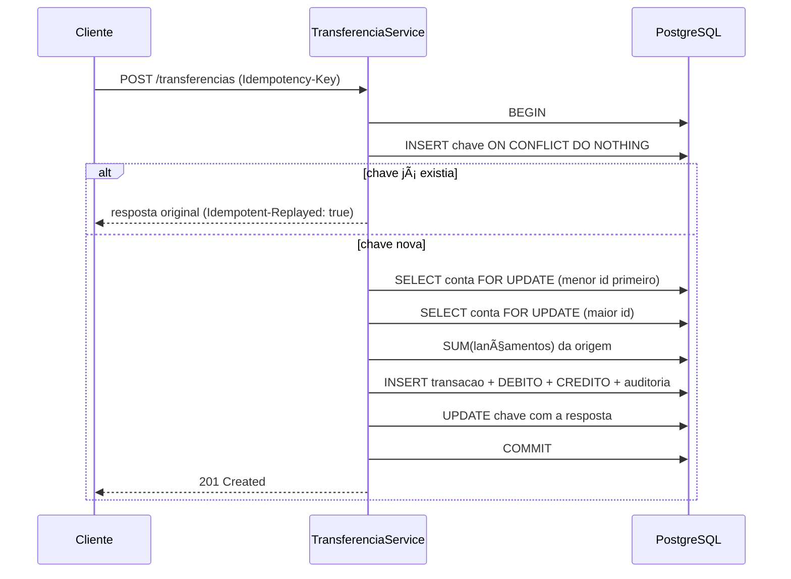

# Ledger API: o núcleo bancário

API REST que funciona como o livro-razão de um banco digital: contas, transferências em **partidas dobradas**, saldo **sempre derivado** dos lançamentos, **idempotência**, bloqueio de saldo negativo sob concorrência, extrato paginado e **auditoria append-only**.

> Projeto de estudo. Todos os dados são sintéticos.

**Stack:** Java 21 · Spring Boot 3.5 · PostgreSQL 16 · Spring Data JPA · Flyway · Bean Validation · springdoc-openapi · JUnit 5 · Testcontainers · JaCoCo · Docker Compose · GitHub Actions

## Arquitetura



### Fluxo de uma transferência



## Decisões principais

| Tema | Decisão | Por quê |
|---|---|---|
| Dinheiro | `BigDecimal` / `NUMERIC(19,2)` | `double` é binário e não representa 0,10 exatamente |
| Saldo | Nunca armazenado; `SUM` dos lançamentos | Não existe número editável que possa divergir do histórico |
| Partidas dobradas | Todo depósito sai da conta interna **Tesouraria** | A soma de todos os saldos do banco é sempre **zero** |
| Concorrência | Lock pessimista (`SELECT ... FOR UPDATE`) em ordem fixa de id | Impede gasto duplo e evita deadlock A→B / B→A |
| Idempotência | `INSERT ... ON CONFLICT DO NOTHING` na mesma transação | Atômico mesmo com repetições simultâneas; falhas não ficam gravadas |
| Append-only | Triggers no banco bloqueiam `UPDATE`/`DELETE` | Vale até para SQL manual, não só para a aplicação |
| Erros | Problem Details (RFC 9457) centralizados | Formato padrão; nunca vaza stack trace ou SQL |

## Como rodar

Pré-requisitos: JDK 21 e Docker Desktop rodando.

```bash
copy .env.example .env
```
```bash
docker compose up -d
```
```bash
.\mvnw spring-boot:run
```

- Swagger: http://localhost:8081/swagger-ui.html
- Saúde: http://localhost:8081/api/v1/saude e http://localhost:8081/actuator/health

### Testes e cobertura

```bash
.\mvnw verify
```

Roda todos os testes contra um PostgreSQL real (Testcontainers) e falha se a cobertura de linhas for menor que 80%. Relatório em `target/site/jacoco/index.html`.

Destaques da suíte:
- `ConcorrenciaIntegracaoTest`: **1.000 transferências simultâneas** entre 10 contas (50 threads) e a soma dos saldos permanece constante. Também dispara 500 saques simultâneos de R$ 1 numa conta com R$ 100: exatamente 100 passam.
- `IdempotenciaIntegracaoTest`: repetição sequencial e **20 repetições simultâneas** com a mesma chave geram uma única transação.
- `AuditoriaExtratoIntegracaoTest`: o banco recusa `UPDATE`/`DELETE` no histórico.

## Endpoints

| Método | Rota | Descrição |
|---|---|---|
| POST | `/api/v1/contas` | Cria conta de cliente |
| GET | `/api/v1/contas/{id}` | Consulta conta e saldo |
| GET | `/api/v1/contas/{id}/extrato?page=0&size=20` | Extrato paginado |
| POST | `/api/v1/depositos` | Depósito (header `Idempotency-Key`) |
| POST | `/api/v1/transferencias` | Transferência (header `Idempotency-Key`) |
| GET | `/api/v1/transferencias/{id}` | Consulta transação |
| GET | `/api/v1/auditoria?entidadeId=` | Eventos de auditoria |

Exemplo:

```bash
curl.exe -X POST http://localhost:8081/api/v1/contas -H "Content-Type: application/json" -d "{\"titular\":\"Cliente Sintetico\"}"
```

## Deploy (Render, plano gratuito)

1. Suba o repositório no GitHub.
2. No Render: **New → Blueprint** e selecione o repositório. O `render.yaml` cria o PostgreSQL e o serviço web a partir do `Dockerfile`.
3. Acesse `https://<seu-servico>.onrender.com/swagger-ui.html`.

## Limitações conhecidas

- Sem autenticação: qualquer pessoa com a URL consulta qualquer conta (fora do escopo da v1).
- Moeda única (BRL), sem juros nem tarifas.
- O saldo é um `SUM` sobre todos os lançamentos da conta; com milhões de lançamentos por conta seria preciso um snapshot periódico de saldo.
- Chaves de idempotência não expiram.
- Requisições que falham (ex.: saldo insuficiente) não ficam gravadas na tabela de idempotência; reenviar a mesma chave reavalia o pedido.
- O lock pessimista serializa operações numa mesma conta muito movimentada (ex.: a Tesouraria nos depósitos).

## Próximos passos

- Autenticação (OAuth2/JWT) e autorização por titular.
- Estorno como nova transação compensatória.
- Snapshots de saldo e particionamento da tabela de lançamentos.
- Expiração das chaves de idempotência.
- Outbox pattern para publicar eventos (Kafka) de forma confiável.
- Métricas e tracing (Micrometer, OpenTelemetry).
